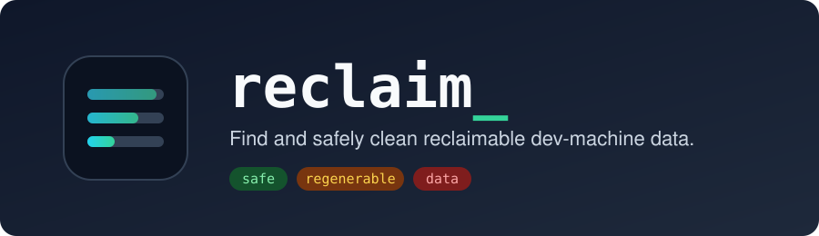
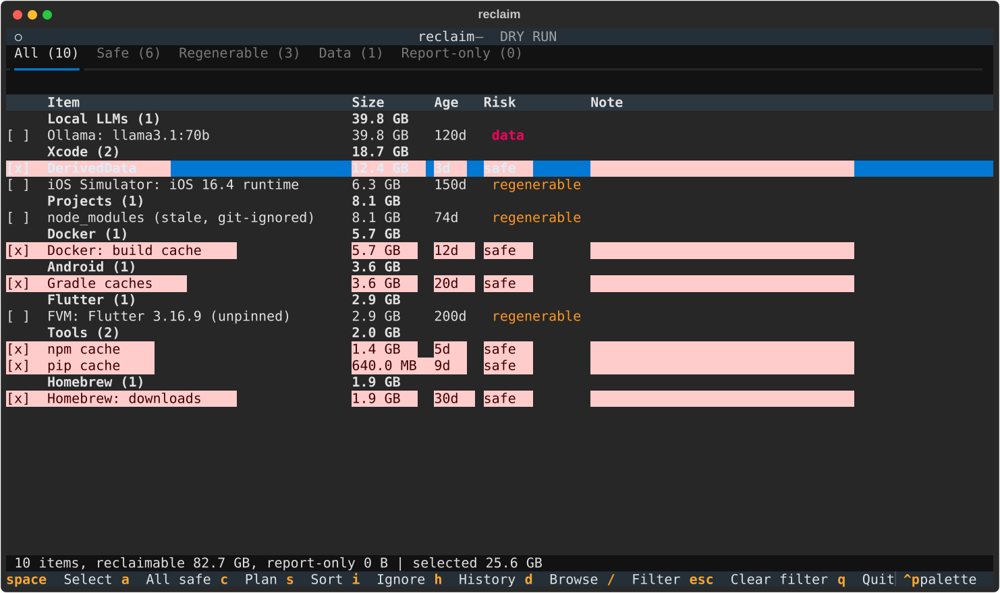

<p align="center">
  
</p>

<p align="center">
  <a href="https://github.com/hussainashraf4u/reclaim/actions/workflows/ci.yml"></a>
  <a href="LICENSE"></a>
  
  
  
  <a href="https://textual.textualize.io/"></a>
</p>

<p align="center">
  <b>An interactive terminal app that finds the caches, build output and forgotten tooling eating your disk, ranks it by size, explains each item, and cleans only what you pick.</b>
</p>

<p align="center">
  <a href="#install">Install</a> ·
  <a href="#usage">Usage</a> ·
  <a href="#safety-model">Safety</a> ·
  <a href="#what-it-finds">What it finds</a> ·
  <a href="#contributing">Contributing</a>
</p>

<p align="center">
  
</p>

> **Status:** early (`0.2.0`). macOS is the primary target; Linux is supported for the XDG cache rules and the cross-platform providers (beta). Contributions are welcome, see [Contributing](#contributing).

## Quick start

```bash
git clone https://github.com/hussainashraf4u/reclaim.git && cd reclaim
python3 -m venv .venv && .venv/bin/pip install -e .
.venv/bin/reclaim --dry-run      # look around first, nothing is ever deleted
```

## Highlights

| | |
| --- | --- |
| 🔍 **Developer-aware** | Knows `DerivedData`, unpinned FVM SDKs, Android NDKs, stale `node_modules`, simulators, Docker, Ollama models. |
| 🛡️ **Hard to delete the wrong thing** | Allowlisted roots only. Never touches `$HOME` or `/`. |
| 👀 **Plan before action** | Every action shown as the exact command or path first. |
| 🚦 **Risk-labelled** | <code>safe</code> · <code>regenerable</code> · <code>data</code> (type the id to confirm) · report-only. |
| ⌨️ **TUI and CLI** | Filter, sort, browse folders, history. Scriptable `clean --yes` and `--json` for cron/launchd. |
| 🧩 **Extensible** | Add a cache with 6 lines of TOML, or write a provider. |

### Risk levels at a glance

| Badge | Meaning | Confirmation |
| --- | --- | --- |
| 🟢 `safe` | Pure cache, rebuilt on demand | Plan screen |
| 🟠 `regenerable` | Re-creatable, but costs time or bandwidth | Plan screen |
| 🔴 `data` | Might be real data | Type the item id |
| ⚪ report-only | Shown, never cleaned | n/a |

## Table of contents

- [Quick start](#quick-start)
- [Highlights](#highlights)
- [Why reclaim](#why-reclaim)
- [Install](#install)
- [Usage](#usage)
- [Safety model](#safety-model)
- [What it finds](#what-it-finds)
- [Configuration](#configuration)
- [Project layout](#project-layout)
- [Contributing](#contributing)
- [Building a standalone executable](#building-a-standalone-executable)
- [Troubleshooting](#troubleshooting)
- [License](#license)

## Why reclaim

Generic disk cleaners know about system caches but not about `DerivedData`, unpinned FVM Flutter SDKs, Android NDKs, stale `node_modules` in a project you haven't opened in a month, or Ollama models you pulled once. `reclaim` knows about those, and it is built around one rule: **it should be hard to delete something you care about.**

- Every action is shown as the exact command or path before anything runs.
- Deletion is restricted to an allowlist of cache locations. It never touches `$HOME` or `/`.
- Anything that could be real data needs you to type its id to confirm.
- Anything it can't clean safely is shown as report-only, so you still see where the space went.

## Install

**Requirements:** macOS or Linux, Python 3.11+. The only runtime dependency is [Textual](https://textual.textualize.io/).

### From source (recommended while the project is young)

```bash
git clone https://github.com/hussainashraf4u/reclaim.git
cd reclaim
python3 -m venv .venv
.venv/bin/pip install -e .
.venv/bin/reclaim
```

With [uv](https://docs.astral.sh/uv/):

```bash
uv run reclaim
```

### Standalone binary

See [Building a standalone executable](#building-a-standalone-executable) to produce a single-file binary you can hand to someone without Python installed.

## Usage

```bash
reclaim                       # launch the TUI
reclaim --dry-run             # TUI, but nothing is ever executed, even after confirming
reclaim --scan-only           # print a ranked table, no TUI
reclaim --scan-only --json    # same, as JSON (scriptable)
reclaim --min-size-mb 200     # hide items smaller than 200 MB (default 50)
reclaim --config PATH         # use another config file
reclaim --version

reclaim clean                 # print the plan for all safe items (nothing executes)
reclaim clean --yes           # ...and execute it (cron / launchd friendly)
reclaim clean --risk regenerable --older-than 60 --yes
reclaim clean --ids homebrew-cache npm-cache --yes
reclaim clean --ids my-volume --allow-data --yes   # data items only by explicit id
reclaim history               # what past runs freed (--json, --limit N)
reclaim doctor                # why is a scanner empty? shows each provider's result
reclaim ignore ID [ID...]     # hide items for good (writes the config); unignore reverses it
```

The first time, run it with `--dry-run` or `--scan-only` to see what it finds.

### TUI keys

| Key      | Action                                   |
| -------- | ---------------------------------------- |
| `space`  | Select / deselect the highlighted item   |
| `a`      | Select everything marked `safe`          |
| `c`      | Show the plan (exact commands) and confirm |
| `/`      | Filter the list by text                  |
| `s`      | Cycle sort: size / age / name / risk     |
| `i`      | Ignore the highlighted item (saved to the config) |
| `d`      | Browse the highlighted item's folder (read-only size browser; `enter` opens, `backspace` goes up) |
| `h`      | Show the cleanup history                 |
| `1`–`5`  | Switch tab: All / Safe / Regenerable / Data / Report-only |
| `esc`    | Clear the filter / close a dialog        |
| `q`      | Quit                                     |

### Risk levels

| Risk          | Meaning                                                                 | Confirmation                |
| ------------- | ----------------------------------------------------------------------- | --------------------------- |
| `safe`        | Pure cache. Gets rebuilt on demand with no loss.                        | Plan screen                 |
| `regenerable` | Can be recreated, but costs time or a download (`node_modules`, SDKs).  | Plan screen                 |
| `data`        | May hold something you want (volumes, models, environments).            | Type the item id to confirm |

### Non-interactive cleaning

`reclaim clean` runs the same safety checks as the TUI. Without `--yes` it only prints the plan. With `--yes`:

- the default selection is every executable item with risk `safe`; `--risk regenerable` adds regenerable ones;
- `--older-than DAYS` keeps only items that report an age (project artifacts);
- `data` items are never part of a bulk selection; name them with `--ids` **and** `--allow-data`;
- the audit log is written, and the freed space is measured and printed;
- the exit code is `3` if any item failed, `2` for bad arguments or config.

Example weekly job (launchd or cron): `reclaim clean --risk regenerable --older-than 60 --yes`.

### JSON output

`--scan-only --json` prints one object:

```jsonc
{
  "version": 1,
  "free_bytes": 123456789012,
  "errors": [],
  "items": [
    {
      "id": "homebrew-cache",
      "label": "Homebrew downloads",
      "group": "System",
      "size_bytes": 1234567890,
      "risk": "safe",
      "why": "Old bottles and downloads.",
      "actions": [{ "type": "run", "argv": ["brew", "cleanup", "-s"] }],
      "disabled_reason": null,
      "report_only": false,
      "executable": true,
      "path": "/Users/you/Library/Caches/Homebrew"
    }
  ]
}
```

### Exit codes

| Code | Meaning                                                   |
| ---- | --------------------------------------------------------- |
| `0`  | Success                                                   |
| `2`  | Invalid config file or invalid `clean` arguments (one error line on stderr) |
| `3`  | `reclaim clean --yes` finished but at least one item failed |

### Scan history and changes

`--scan-only` and the TUI remember each item's size in `~/.cache/reclaim/last_scan.json`, so output can show growth ("+1.2 GB since last scan"). `reclaim history` reads the audit log and prints what each run freed plus a lifetime total.

## Safety model

Safety is the core of this project, so it is documented in full. Please read this before sending a PR that touches deletion.

1. **Plan first.** Every clean is rendered as an exact command (`rm -rf '<path>'` or an argv such as `brew cleanup -s`) on the plan screen before it runs.
2. **Allowlist of roots.** `RemovePath` actions are checked by `check_removable` in [`src/reclaim/safety.py`](src/reclaim/safety.py). A path must be:
   - absolute and free of `..`
   - not `/`, `$HOME`, or an ancestor of `$HOME`
   - inside an allowlisted root, checked against both the resolved path **and** the link location, so a symlink can't smuggle a deletion outside the allowlist
3. **Scoped roots.** Project roots from your config only allow specific artifact names (`node_modules`, `build`, `.venv`, `target`, ...), never arbitrary files in your project.
4. **Stale and ignored only.** Project artifacts are listed only when untouched for `stale_days` and git-ignored, so nothing tracked by git is offered.
5. **Busy-process check.** Items can declare processes that must not be running (for example a tool whose cache is in use). If one is running, the item is skipped with a message.
6. **Type-to-confirm for `data`.** You must type the id of every `data` item in the plan.
7. **Dry run.** `--dry-run` never executes, even after you confirm.
   **Trash for data.** With `use_trash = true` in the config, `data` items are moved to `~/.Trash` instead of deleted, so they can be put back. The move goes through the same allowlist check.
8. **Audit log.** Every run is appended to `~/.local/state/reclaim/log.jsonl` with timestamp, item, success, output and bytes freed.
9. **Config can't widen the blast radius.** `project_roots` and `extra_allowlist` are rejected if they are `/`, your home, an ancestor, contain `..`, sit under `~/Library` (project roots), or point at `.ssh`, `.gnupg` or `Keychains`. `extra_allowlist` entries must be at least two levels below home.

10. **Plugin roots are restricted.** Roots contributed by third-party providers (see [Plugins](#plugins)) must be specific folders at least two levels below home (three under `~/Library`) and never `.ssh`, `.gnupg` or `Keychains`; others are dropped.

There is a test that runs every provider against a fake home and asserts that **every** remove action it emits passes the guard ([`tests/test_all_providers_safe.py`](tests/test_all_providers_safe.py)). New providers must keep it green.

## What it finds

### Catalog (static, declarative)

Simple "this folder is a cache" rules live in TOML files under [`src/reclaim/catalog_data/`](src/reclaim/catalog_data): `js.toml`, `languages.toml`, `mobile.toml`, `python.toml`, `system.toml`. They cover things like Homebrew downloads, user logs, the Trash, and package manager, language and mobile tooling caches.

### Providers (logic-driven)

Anything that needs inspection rather than a fixed path is a provider:

| Provider            | What it reports / cleans                                                                                         |
| ------------------- | ---------------------------------------------------------------------------------------------------------------- |
| Docker              | Build cache, unused images, stopped containers, unattached volumes                                               |
| Git worktrees       | Clean checkouts only; the branch is kept                                                                         |
| Project artifacts   | `node_modules`, `build`, `.venv`, `target` and similar in your project roots, only when stale and git-ignored    |
| Android             | AVD userdata overlays; NDKs Flutter does not need                                                                |
| FVM                 | Flutter versions no project pins                                                                                 |
| Node versions       | nvm/fnm Node versions that are neither the default nor pinned by a project                                       |
| iOS Simulators      | Unavailable and shut-down devices                                                                                |
| Ollama              | Downloaded models (needs the server running; scanning never launches it)                                         |
| Conda               | Environments and package cache                                                                                   |
| Time Machine        | Local snapshots (**report only**)                                                                                |
| Large directories   | Bounded scan for big folders no rule covers (**report only**)                                                    |
| Rustup              | Toolchains that are neither the default, an override, nor named by a `rust-toolchain` file                       |
| Version managers    | pyenv, rbenv, asdf, mise and SDKMAN versions that are neither global nor pinned (`.python-version`, `.tool-versions`, `.sdkmanrc`, ...) |
| Homebrew            | Unused dependencies (`brew autoremove`)                                                                          |
| VM disks            | Colima, Lima, OrbStack and Podman machine disks (**report only**)                                                |
| Big files           | Single large files in Documents, Desktop, Movies, Downloads, Music, Pictures (**report only**)                   |
| Duplicates          | Identical large files, sized by the redundant copies (**report only**)                                           |

Providers that need project knowledge (worktrees, artifacts, FVM, Node versions, Rustup, version managers) require `project_roots` in your config, because they need to know what your projects pin.

## Configuration

Optional. Default location: `~/.config/reclaim/config.toml`. All keys are optional:

```toml
project_roots   = ["~/Documents/projects"]   # enables worktree / artifact / FVM / Node-version providers
extra_allowlist = []                          # extra removable roots (be conservative)
ignore          = ["trash"]                   # item ids to hide
min_size_mb     = 50                          # hide items smaller than this
stale_days      = 30                          # age before a project artifact counts as stale
large_dir_mb    = 1000                        # size above which unmanaged folders are listed
big_file_mb     = 500                         # size above which single files are reported
duplicate_min_mb = 100                        # smallest file considered for duplicate detection
use_trash       = false                       # move data-risk items to the Trash instead of deleting
```

Paths must start with `~/` or `/`. Unknown keys are an error, and a bad config prints a single error line and exits with code `2`.

## Plugins

Third-party packages can add providers without a PR. Expose a zero-argument callable (usually a class) in the `reclaim.providers` entry point group:

```toml
# the plugin's pyproject.toml
[project.entry-points."reclaim.providers"]
mytool = "reclaim_mytool:MyToolProvider"
```

The provider needs a `name` and `scan(ctx) -> Iterable[Item]`, and follows the same rules as built-in providers (read-only scans, use only `ctx`). A plugin that fails to load is skipped with a warning. Its `roots()` are filtered as described under the safety model.

## Linux

The XDG cache rules in `catalog_data/linux.toml` and the cross-platform providers (project artifacts, version managers, Rustup, Docker, Ollama, big files, duplicates, ...) work on Linux. macOS-only scanners (Xcode, simulators, Time Machine) simply report nothing there. Linux is a beta target: expect gaps in distro-specific caches, and please open issues.

## Project layout

```
src/reclaim/
├── cli.py            argument parsing, wiring, --scan-only output
├── tui.py            Textual app: tabs, table, plan / run / detail screens
├── tui.tcss          Textual stylesheet (bundled into the executable)
├── scan.py           runs catalog + providers, collects errors, reports progress
├── runner.py         runs a list of items, audits each, measures freed space (TUI and `clean`)
├── scancache.py      remembers sizes between scans to show growth
├── catalog.py        loads and validates catalog_data/*.toml
├── catalog_data/     declarative cache rules (TOML)
├── providers/        logic-driven scanners (docker, android, fvm, ...)
├── model.py          Item, Risk, RemovePath, Run
├── safety.py         the deletion allowlist and guard
├── executor.py       runs an item's actions, busy checks, dry run
├── audit.py          append-only JSONL log
├── config.py         config loading and validation
├── context.py        ScanContext: injectable home, which, run, sizer, clock
├── sizing.py         fast directory sizing
├── selection.py      selection state and plan text
└── units.py          size parsing and formatting
tests/                pytest suite (335 tests)
scripts/              build_executable.sh
```

`ScanContext` injects everything environment-specific (home directory, `which`, command runner, process check, clock), so scanners are tested against a fake home without touching your real disk.

## Contributing

Contributions are very welcome, especially new cache rules and providers for tools you use.

### Dev setup

```bash
git clone https://github.com/hussainashraf4u/reclaim.git
cd reclaim
python3 -m venv .venv
.venv/bin/pip install -e . pytest pytest-asyncio
.venv/bin/pytest
```

Or with uv: `uv sync && uv run pytest`.

### Add a cache (the easy way)

Add an entry to a file in `src/reclaim/catalog_data/`:

```toml
[[item]]
id    = "my-cache"
label = "My cache"
group = "Tools"
path  = "~/.cache/my-tool"        # or: glob = "~/Library/Foo/*"
risk  = "safe"                     # safe | regenerable | data
why   = "Why it grows and what happens if removed."

# optional
clean = { run = ["my-tool", "cache", "clean"] }   # use a tool's own cleaner instead of rm
needs = "my-tool"                                 # only show if this binary is on PATH
busy  = ["MyApp"]                                 # refuse to clean while this process is running
```

Rules:

- Use exactly one of `path` or `glob`, and start it with `~/` or `/`.
- If the path is outside `safety.default_roots`, add its root there. The catalog test fails otherwise, on purpose.
- Be honest in `why` and pick the **more** cautious risk when unsure.

### Add a provider (when a fixed path isn't enough)

1. Create `src/reclaim/providers/<name>.py` with a class that has a `name` and a `scan(ctx) -> Iterator[Item]` method. Optionally add `roots(ctx) -> list` to contribute removable roots.
2. Register it in `all_providers()` in `src/reclaim/providers/__init__.py`.
3. Use only `ctx` (`ctx.home`, `ctx.which`, `ctx.run`, `ctx.is_running`, ...), never the real environment, so it's testable.
4. Scanning must be **read-only** and must not launch applications.
5. Add `tests/test_<name>.py` and make sure `tests/test_all_providers_safe.py` still passes.

### Guidelines

- **Safety changes need extra scrutiny.** Anything that widens the allowlist or weakens a check needs a clear justification and a test.
- Keep scans fast: skip anything below `ctx.min_size`, bound any directory walks.
- Follow the surrounding style. The codebase uses type hints and `from __future__ import annotations`.
- Add or update tests for every behaviour change; run `pytest` before opening a PR.
- Open an issue first for large changes.

## Releases and distribution

- `.github/workflows/ci.yml` runs the tests on macOS and Linux (Python 3.11 and 3.13), plus ruff, mypy and a catalog/allowlist job.
- `.github/workflows/release.yml` builds the macOS binary, publishes to PyPI via trusted publishing, and attaches the zip to a GitHub release when you push a `v*` tag. Set up the `pypi` environment and trusted publisher on PyPI once.
- `packaging/reclaim.rb` is a Homebrew formula template for your own tap.
- `packaging/NOTARIZE.md` lists the manual signing and notarization steps (needs an Apple Developer ID).

## Building a standalone executable

```bash
scripts/build_executable.sh
```

This creates `.venv` if needed, installs a pinned PyInstaller, builds a single-file binary, smoke-tests it against an empty `HOME`, and packages it:

```
dist/reclaim
dist/reclaim-<version>-macos-<arch>.zip
dist/reclaim-<version>-macos-<arch>.zip.sha256
```

Verify a download with `cd dist && shasum -a 256 -c reclaim-*.zip.sha256`.

**Sharing notes**

- The binary matches the machine it was built on (arm64 vs x86_64) and targets macOS 11+.
- It is only ad-hoc signed, so macOS Gatekeeper will block a downloaded copy. Recipients can run:
  ```bash
  xattr -d com.apple.quarantine ./reclaim
  ```
  For frictionless distribution, sign with a Developer ID and notarize.
- The smoke test does not start the TUI (it needs a terminal); run `dist/reclaim` once by hand before publishing a release.

## Troubleshooting

- **"reclaim: ... unknown key(s)" / exit code 2:** your config file has a typo or an invalid path. The message names the file and key.
- **Project artifacts, worktrees, FVM or Node versions never show up:** set `project_roots` in your config.
- **Ollama models are missing:** the server must be running; `reclaim` deliberately won't start it.
- **An item can't be selected:** the Note column shows why (`disabled reason` or `report only`). Report-only items (Time Machine snapshots, large folders) are never cleaned by `reclaim`.
- **"<app> is running":** an item declares apps that must be closed first (for example Xcode). Quit the app and run again.
- **Space didn't change after cleaning:** APFS snapshots and Time Machine local snapshots can hold freed space. Time Machine snapshots are report-only.

## License

MIT, see [`LICENSE`](LICENSE).
